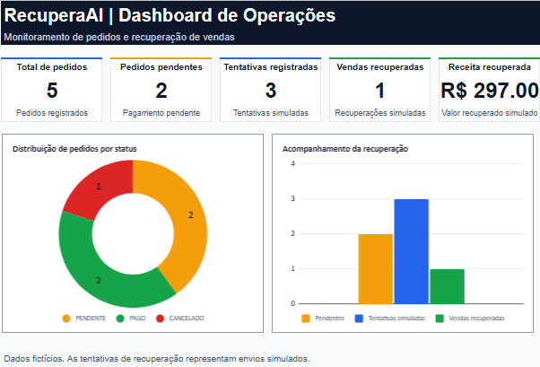
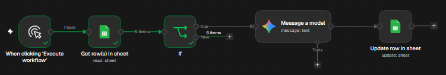

# RecuperaAI

Automação de recuperação de vendas para uma operação fictícia de cursos online. O fluxo seleciona pedidos pendentes, gera uma mensagem personalizada com o Gemini e registra a tentativa simulada no Google Sheets. Um painel acompanha os pedidos e os resultados da simulação.

## Como funciona

1. O gatilho manual inicia a leitura da aba `Pedidos` no Google Sheets.
2. O n8n seleciona pedidos com status `PENDENTE`, sem tentativa registrada e criados há pelo menos 30 minutos. A leitura usa datas em formato serial e o filtro interpreta o horário no fuso `America/Sao_Paulo`.
3. O Gemini gera uma mensagem usando o nome, o produto e o valor do pedido. O prompt orienta o modelo a evitar descontos e urgência inventados.
4. O n8n localiza o pedido por `pedido_id` e preenche `mensagem_ia` e `tentativa_registrada = SIM`. Na próxima execução, esse pedido fica fora da fila.
5. O dashboard acompanha pedidos por status, tentativas registradas, vendas recuperadas e receita recuperada. A confirmação do pagamento e a classificação da recuperação são feitas manualmente para a demonstração.

## Testes realizados

| Cenário | Resultado observado |
|---|---|
| Pedido do Lucas pendente há 25 minutos, sem tentativa | O pedido caiu na saída falsa do filtro. |
| Mesmo pedido pendente há 35 minutos | O pedido passou pelo filtro. O fluxo completo gerou a mensagem e registrou a tentativa. |
| Segunda execução após o registro | Nenhum pedido voltou a ser selecionado. |
| Pagamento simulado do pedido do João | O painel passou a mostrar 1 venda recuperada, R$ 297 de receita simulada e 2 pedidos pendentes. |

A geração de mensagens, a leitura e a gravação foram executadas nas ferramentas integradas. Os pedidos, o envio e os pagamentos são simulados.

## Como reproduzir

1. Importe [dados-exemplo.csv](dados-exemplo.csv) no Google Sheets e chame a aba de `Pedidos`. Configure o fuso da planilha para São Paulo (UTC−03:00). Confira se `valor` é numérico e `criado_em` é reconhecido como data e hora. Para o teste do Lucas, você pode preencher G6 com `=NOW()-35/1440`.
2. Importe [recuperaai-workflow.json](recuperaai-workflow.json) no n8n. Nos dois nodes do Google Sheets, conecte sua conta, escolha sua planilha e confirme a aba `Pedidos`. No node do Gemini, configure sua credencial e selecione um modelo de texto disponível, se necessário.
3. Rode o fluxo manualmente e confira a mensagem e o registro da tentativa na planilha. Para testar só o filtro, execute o node de leitura e depois o `If`.
4. Para montar o painel, crie a aba `Dashboard`, preencha `A1:B6` conforme a tabela abaixo e copie [dashboard.gs](dashboard.gs) para um projeto separado do Google Apps Script. Preencha o link da sua planilha no início do script e execute `criarDashboardRecuperaAI`.

| Célula em A | Indicador | Valor ou fórmula na célula em B |
|---|---|---|
| A1 | Indicador | `Valor` |
| A2 | Total de pedidos | `=COUNTA(Pedidos!A2:A)` |
| A3 | Pedidos pendentes | `=COUNTIF(Pedidos!F2:F,"PENDENTE")` |
| A4 | Tentativas registradas | `=COUNTIF(Pedidos!H2:H,"SIM")` |
| A5 | Vendas recuperadas | `=COUNTIF(Pedidos!J2:J,"SIM")` |
| A6 | Receita recuperada | `=SUMIF(Pedidos!J2:J,"SIM",Pedidos!E2:E)` |

As fórmulas estão em inglês. Use ponto e vírgula como separador de argumentos se a localidade da sua planilha exigir.
